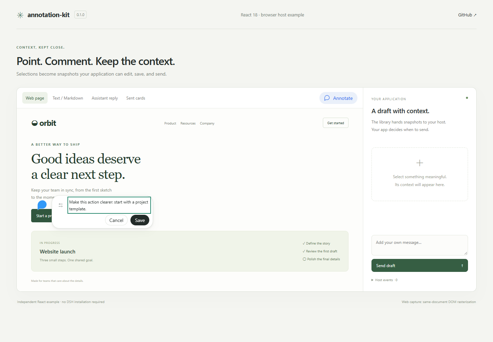
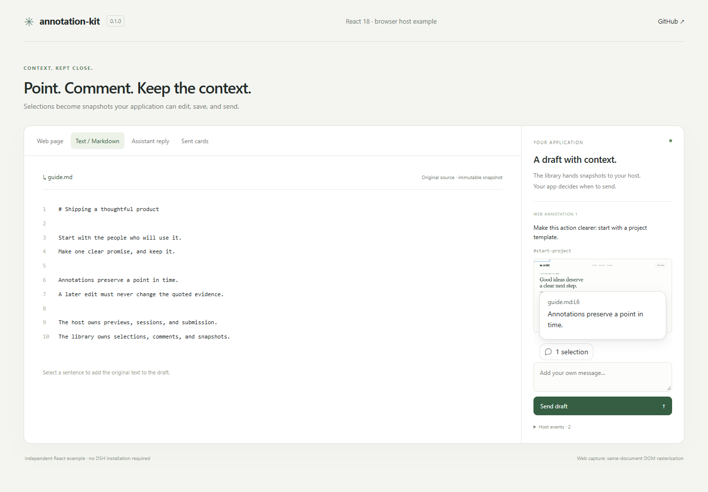
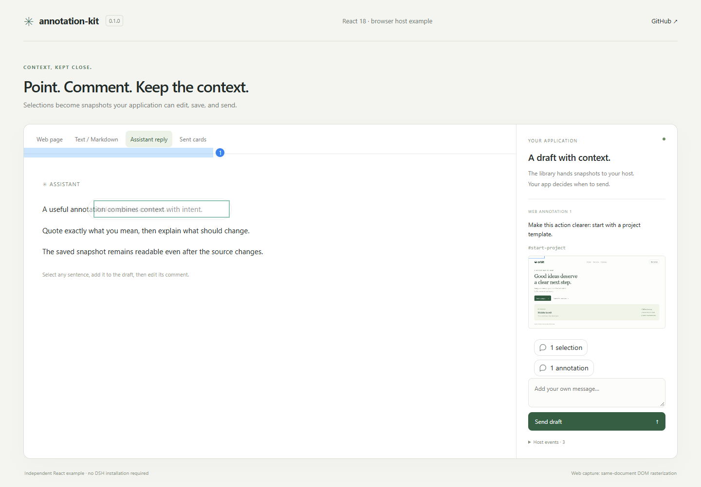
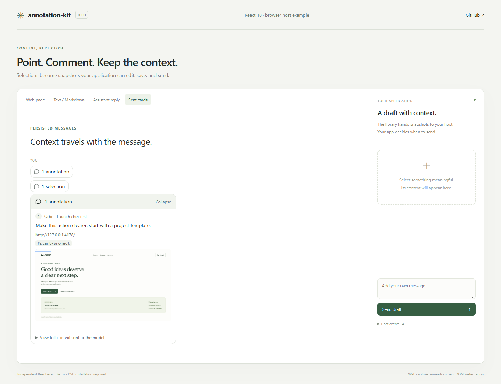
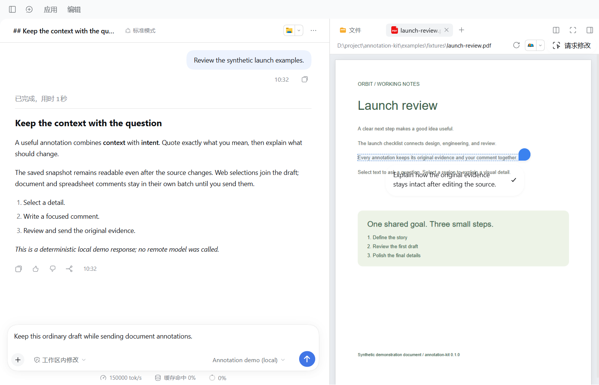
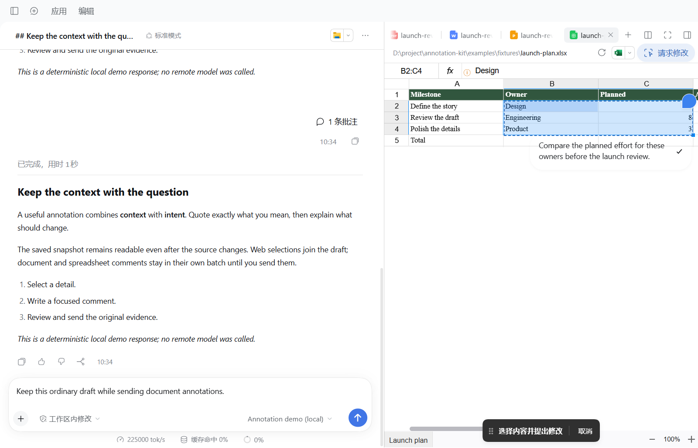

# annotation-kit

Annotations for web pages, documents, spreadsheets, and conversation text. React 18 UI, immutable evidence, editable comments, and host-controlled submission.

[中文文档](README.zh-CN.md) · [Host integration](docs/host-integration.md) · [DSH rc.5 example](examples/dsh/README.md)



| Surface | What gets preserved | Save behavior |
| --- | --- | --- |
| Web element / region | URL, element context, geometry, original PNG | Adds to your application's draft |
| Code / text / Markdown | Original text and source location | Adds a text reference to the draft |
| PDF / Word / PowerPoint | Selected text, page anchors, or cropped page pixels | Saves an independent document batch |
| XLSX / CSV | Sheet identity, cells, displayed/raw values, formulas, range | Saves an independent document batch |
| Assistant reply | Stable message location, original quote, optional comment | Adds an editable reference to the draft |
| Sent message | Versioned card metadata plus original evidence | Remains readable after the source changes |

PowerPoint's plain-text quick request submits directly. Ordinary document and spreadsheet comments remain in their source batch until Send. A failed admission retains the pending content; session changes, navigation, cancellation and unload invalidate pending selections.

<details>
<summary>More screenshots</summary>







See [screenshot environments and verification](docs/verification.md) for the DSH PDF/Office and spreadsheet examples. Images are captured from the running extracted examples, using synthetic content.

</details>

## Install

```sh
npm install annotation-kit@0.1.0 react@18 react-dom@18
```

```tsx
import { en, type TextSnapshot } from 'annotation-kit'
import { SelectionCard } from 'annotation-kit/react'
import 'annotation-kit/styles.css'

const quote: TextSnapshot = {
  version: 1, id: 'quote-1', kind: 'text',
  address: 'memory://example/notes.txt', text: 'Keep the original evidence.',
  startLine: 1, endLine: 1, startColumn: 1, endColumn: 28,
}

export function SavedQuote() {
  return <SelectionCard items={[quote]} initiallyOpen t={key => en[key]} />
}
```

Your application retains its React root. The package externalizes React and React DOM. Import the stylesheet once through your CSS-aware bundler; Vite consumers normally include `vite/client` in their type environment.

## Run the independent React example

```sh
git clone https://github.com/leung-alex/annotation-kit.git
cd annotation-kit
corepack pnpm install --frozen-lockfile
pnpm build
pnpm dev
```

Open `http://127.0.0.1:4178`. Select a web element or region, add text or an assistant quote, edit the comment, and send the draft. The host event panel shows the received data. Sent messages survive a refresh. Browser image capture in this example uses same-document DOM rasterization; Electron hosts use native `capturePage`.

## Entry points and host integration

| Entry | Responsibility |
| --- | --- |
| `annotation-kit` | Snapshots, codecs, selection readers, state, image and batch lifecycle |
| `annotation-kit/react` | Selection actions, comment editors, markers, batch controls and cards |
| `annotation-kit/electron` | Owned-guest selection/capture bridge and sandbox-compatible preload builder |

Implement `ComposerBridge` to connect the current session, draft insertion, independent batch submission and draft editing. Supply your own viewers, Markdown renderer, workbook and source navigation. The library does not ship an Office converter, PDF viewer, model service, DSH Context, or application runtime directory.

Read the [host contract and selection recipes](docs/host-integration.md). The independent [React host](examples/react/host.ts) and complete [DSH adapter](examples/dsh/plugin/src/client/index.ts) are working implementations.

## DSH rc.5 example

```sh
pnpm dsh:prepare
pnpm dsh:build
pnpm dsh:check
pnpm dsh:start
```

The helper clones official **DSH 0.2.1-rc.5**, commit `b830ec950faba0a46dda564be3e2d854afed94f1`, under `.dsh/runtime`, checks its version and source state, and applies the [registered patch](examples/dsh/patches/dsh-0.2.1-rc.5.patch). Its data and Electron profile are isolated under `.dsh/`. It adds annotation seats, structured-reference presentation, image admission and an owned Electron bridge; it retains DSH's frame and normal browser policy.

The example includes a deterministic **local demo model**. Select “Annotation demo (local)” to exercise real DSH submission and persistence without a remote provider. This model does not inspect images or call tools. See the [complete instructions, sample files and revert command](examples/dsh/README.md).

This npm package is a library. The DSH example requires the documented source patch and a rebuilt desktop app; it does not claim installation into an unmodified DSH app through its plugin marketplace.

## Environments and limitations

- React / React DOM 18; Node 22.19+ for development and Electron build tooling.
- Browser selection uses rendered DOM; PDF selection requires the viewer's text layer and page canvas. Markdown source locations are omitted when DOM/source parity cannot be established.
- Spreadsheet integration accepts the host's FortuneSheet 1.0.4 workbook. DSH's patched read-only workbook and parser remain host-owned.
- Electron image capture requires a visible, owned application window and an authorized guest main frame. Cross-origin frames and canvas use region selection.
- Storage namespaces and native IPC channel prefixes are configurable. The v1 reference codecs retain their historical `aione-*` wire identifiers so existing data can be read; these are format identifiers, not application dependencies.
- Current validation and platform scope are recorded in [verification](docs/verification.md). Platforms and versions not exercised there are unverified.

## Development

```sh
pnpm verify       # types, behavior tests, build and external packed consumer
pnpm build:demo
pnpm test:demo    # running demo + Microsoft Edge required on Windows
```

`npm pack` contains built entry points, declarations, CSS, preloads, README files and license notices. DSH source, application data, logs, screenshots and example build caches are excluded from the npm tarball. Examples and screenshots live in this repository.

MIT © leung-alex. See [LICENSE](LICENSE) and [NOTICE](NOTICE) for third-party attribution, including DeepSeek Harness and react-grab.
