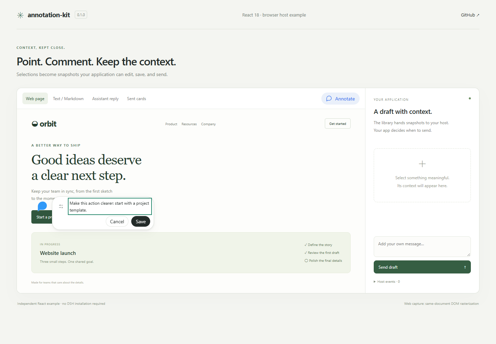
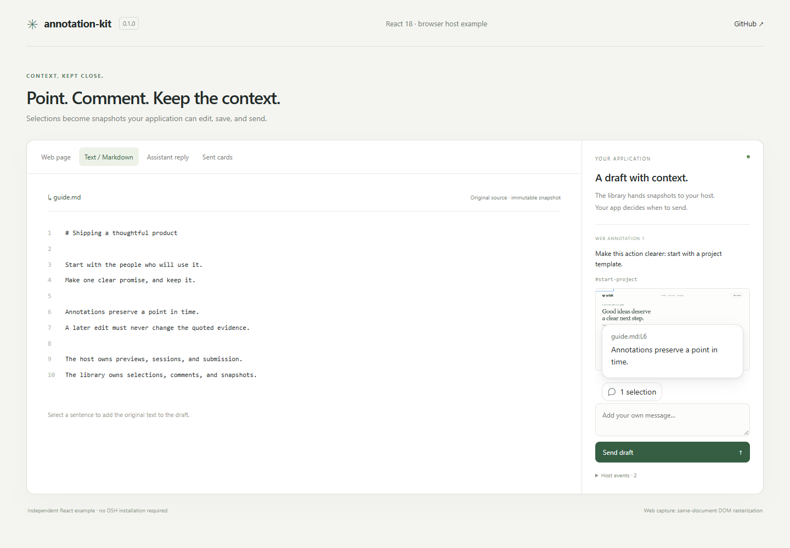
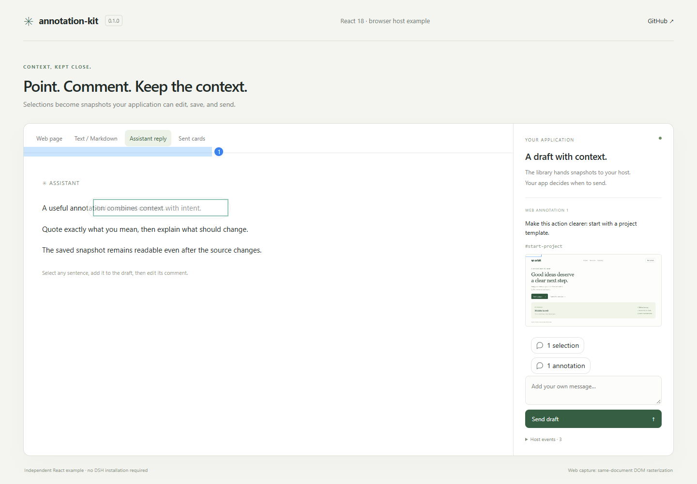
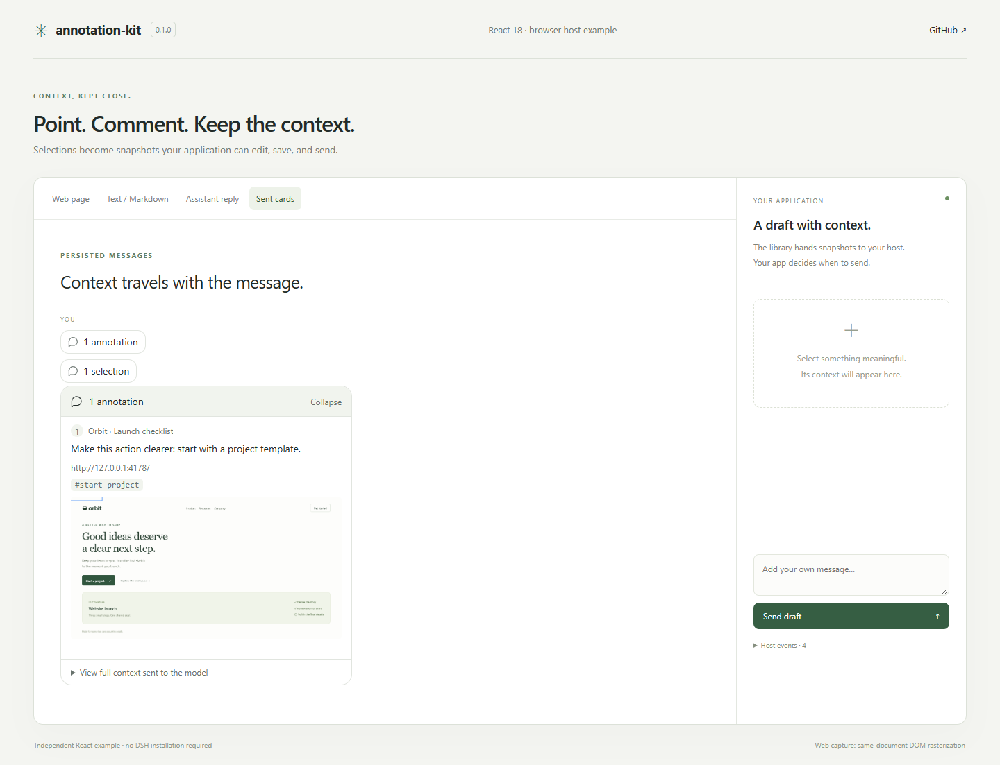
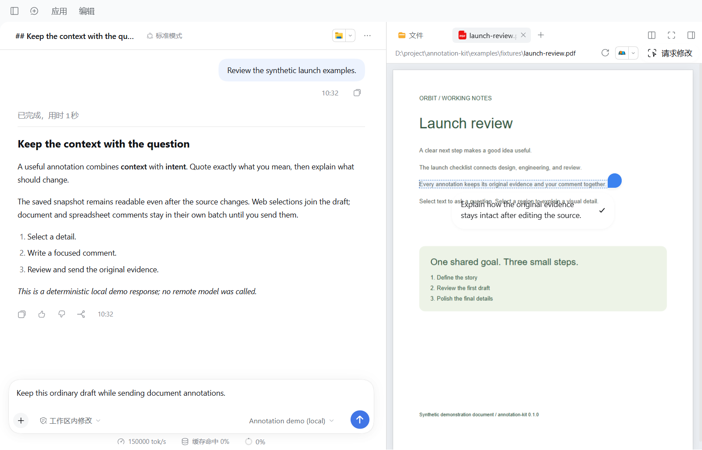
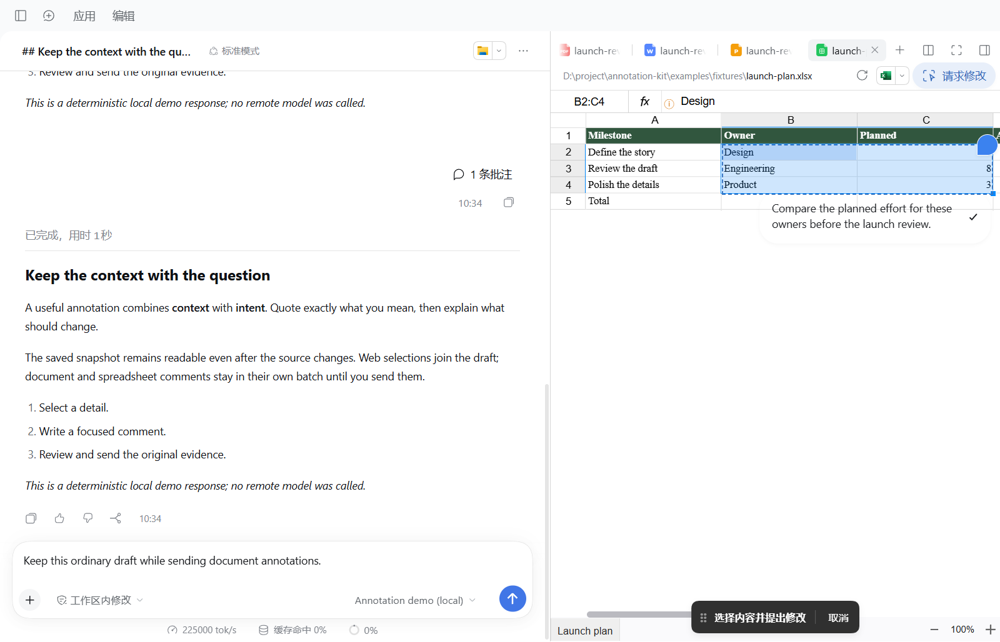

# annotation-kit

把网页、文档、表格和助手回复中的一段内容，保存为带评论的批注。提供 React 18 界面，保留选中时的原文和图片，由接入的应用负责草稿、会话和发送。

[English](README.md) · [接入接口](docs/host-integration.zh-CN.md) · [DSH 完整示例](examples/dsh/README.zh-CN.md)



| 场景 | 保存的内容 | 保存后的去向 |
| --- | --- | --- |
| 网页元素、网页区域 | 页面地址、元素信息、位置、截图、评论 | 应用的输入草稿 |
| 代码、普通文本、Markdown | 原文、来源地址、可确定的行列位置 | 输入草稿中的结构化引用 |
| PDF、Word、PPT | 文本、页码、选区位置或页面局部截图 | 当前会话、当前文件的独立批次 |
| XLSX、CSV | 工作表、单元格范围、显示值、原始值、公式 | 当前会话、当前文件的独立批次 |
| 助手回复 | 原始引用、消息位置、可编辑评论 | 输入草稿 |
| 发送后卡片 | 版本化展示数据与原始证据 | 会话消息，可展开查看 |

PPT 普通文字的快捷请求直接提交；文档和表格的普通批注先保存，点击发送才提交。发送失败保留待处理内容，会话切换、网页导航、取消和卸载会中止过期操作。







PDF/Office、表格的 DSH 实际效果和各张图的环境说明见[验证记录](docs/verification.md)。全部使用生成的演示材料，从抽离后的运行示例重新截图。

## 安装和最小示例

```sh
npm install annotation-kit@0.1.0 react@18 react-dom@18
```

```tsx
import { zh, type TextSnapshot } from 'annotation-kit'
import { SelectionCard } from 'annotation-kit/react'
import 'annotation-kit/styles.css'

const snapshot: TextSnapshot = {
  version: 1, id: 'quote-1', kind: 'text',
  address: 'memory://example/notes.txt', text: '保留选中时的原文。',
  startLine: 1, endLine: 1, startColumn: 1, endColumn: 10,
}

export function SavedQuote() {
  return <SelectionCard items={[snapshot]} initiallyOpen t={key => zh[key]} />
}
```

宿主继续管理 React 根节点，库使用宿主的 React 和 React DOM，不打包第二份 React。样式通过支持 CSS 的构建工具加载一次；Vite 项目通常在类型配置中包含 `vite/client`。

## 不安装 DSH 也能运行

```sh
git clone https://github.com/leung-alex/annotation-kit.git
cd annotation-kit
corepack pnpm install --frozen-lockfile
pnpm build
pnpm dev
```

访问 `http://127.0.0.1:4178`。网页页签可以选择元素、拖选区域并评论；文字页签可以选中原文；助手页签可以引用回复并编辑评论；发送后可以在卡片页签查看结果，刷新后仍保留。右侧事件面板展示宿主接收到的操作。

独立示例通过同一文档内的 DOM 栅格化生成图片，Electron 示例使用原生网页截图。两种宿主的截图方式会在截图说明中分别标明。

## 库和应用如何分工

| 入口 | 提供的能力 |
| --- | --- |
| `annotation-kit` | 批注数据、锚点、原文快照、状态、图片和批次管理 |
| `annotation-kit/react` | 选区按钮、评论框、标记、批次工具条、预览和发送后卡片 |
| `annotation-kit/electron` | 网页选取与截图桥、沙箱预加载脚本生成 |

应用实现 `ComposerBridge`，提供当前会话、加入输入草稿、独立批次发送和草稿编辑。PDF/Office 预览、Markdown 渲染、表格工作簿、打开来源、身份与权限仍由应用提供。库不依赖 Aione 服务、DSH 的 `Context` 或某个本地目录。

完整的[宿主接口和各类选区用法](docs/host-integration.zh-CN.md)解释了具体参数、保存规则、错误处理、图片生命周期以及 Electron 接入。可直接参考[独立宿主代码](examples/react/host.ts)和 [DSH 接入代码](examples/dsh/plugin/src/client/index.ts)。

## DSH 的补丁如何使用

```sh
pnpm dsh:prepare
pnpm dsh:build
pnpm dsh:check
pnpm dsh:start
```

这些命令在 `.dsh/runtime` 创建干净的官方 **0.2.1-rc.5** 副本，固定提交 `b830ec950faba0a46dda564be3e2d854afed94f1`，校验后应用[配套补丁](examples/dsh/patches/dsh-0.2.1-rc.5.patch)。数据与 Electron 配置也在独立目录中。补丁提供浏览器插槽、助手正文入口、结构化引用展示、图片附件接入和截图桥；保留官方外壳与原有浏览器隔离规则。

示例带有明确标注的本地演示模型。选择 “Annotation demo (local)” 即可演练实际提交和恢复，无需配置远程模型。它只返回固定演示文字，不识别图片、不调用工具。完整步骤、样例文件、检查与撤销见 [DSH 中文指南](examples/dsh/README.zh-CN.md)。

这里发布的是一个普通 npm 库。DSH 示例需要应用补丁并重新构建桌面程序，不能直接在未经修改的 DSH 插件市场中安装。自己开发的 React/Electron 应用可以直接引用库，并自行实现宿主接口。

## 环境、兼容和限制

- 使用 React / React DOM 18；开发及 Electron 构建工具需要 Node 22.19 或更高版本。
- 网页和文字选区依赖实际渲染的 DOM；PDF 需要预览器提供文字层和页面画布。Markdown 无法确定原文与 DOM 对应关系时，不编造行号。
- 表格由宿主提供 FortuneSheet 1.0.4 工作簿；DSH 的只读修复、解析器与文件转换仍由宿主管理。
- Electron 截图要求应用窗口可见，目标属于当前窗口且是受控网页的主框架；跨域 iframe、Canvas 可使用区域选取。
- 存储命名和 IPC 通道前缀可配置。为了继续读取历史数据，v1 引用格式保留原有 `aione-*` 标识；这些是数据格式标识，不是服务依赖。
- 已验证版本、平台和实际检查范围以[验证记录](docs/verification.md)为准。未实测的平台明确记为未验证。

## 开发和许可证

```sh
pnpm verify
pnpm build:demo
pnpm test:demo  # 先运行 pnpm dev；Windows 示例检查使用 Microsoft Edge
```

npm 包包含编译后的入口、类型、CSS、预加载脚本、README 和许可证。DSH 源码、应用数据、日志、截图、示例缓存均不进入 npm 包；示例与图片在 GitHub 仓库中提供。

采用 MIT，版权归 leung-alex。第三方声明见 [NOTICE](NOTICE)，包括 DeepSeek Harness、react-grab 等；完整许可见 [LICENSE](LICENSE)。
